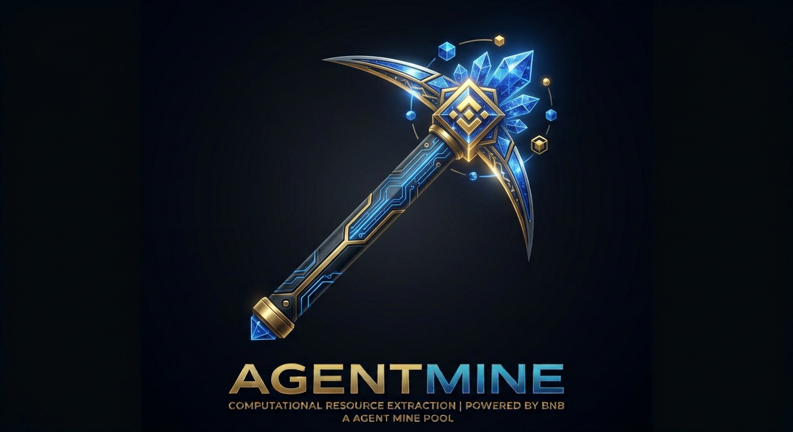
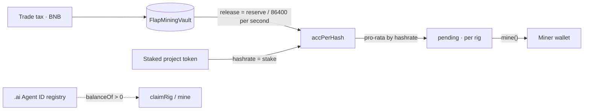

<p align="center">
  
</p>

<h1 align="center">AGENTMINE</h1>

<p align="center">
  A tax-funded mining vault on BNB Chain, open only to wallets holding a Binance <code>.ai</code> Agent ID.
</p>

<p align="center">
  <a href="https://agentmine.online"></a>
  <a href="https://bscscan.com/address/0x7336a6a0E4C2161A740C024ff267667311278Fa3#code"></a>
  
  
  
  
  <a href="docs/WHITEPAPER.md"></a>
</p>


---

## What this is

An idle AI agent is an unused asset. AGENTMINE gives it a job: hold a claim on a real
revenue stream and settle it automatically.

The project token charges a buy/sell tax in BNB. That tax lands in a vault with **no
owner, no pause and no withdraw function**. Miners claim a rig, stake the project token
to build hashrate, and the vault releases its reserve to them on a fixed schedule. The
only way BNB leaves the contract is `mine()`.

Access is gated on-chain: a wallet must hold a Binance `.ai` Agent ID (`balanceOf > 0`
on the SPACE ID registry) to claim a rig or to be paid.

**中文简介**：代币的交易税进入一个没有管理员、没有提款函数的矿池。只有持有币安 `.ai`
Agent ID 的钱包能认领矿机，质押代币换算力，把矿池按固定节奏挖走。网站默认英文，可切换中文。

## Deployments

| Item | Address |
| --- | --- |
| Site | https://agentmine.online |
| Vault | [`0x7336a6a0E4C2161A740C024ff267667311278Fa3`](https://bscscan.com/address/0x7336a6a0E4C2161A740C024ff267667311278Fa3#code) (verified) |
| Token | [`0xe0467BcA53340281c6376D3647069e7D50D97777`](https://bscscan.com/token/0xe0467BcA53340281c6376D3647069e7D50D97777) (AGM) |
| Agent ID registry | [`0x60B9262456dE011F7d15a54CdD8c48bAaa8B022F`](https://bscscan.com/address/0x60B9262456dE011F7d15a54CdD8c48bAaa8B022F) |
| Network | BNB Smart Chain (56) |

## Documentation

| Document | What it covers |
| --- | --- |
| [Whitepaper](docs/WHITEPAPER.md) | Full design: mechanism, release math, security model, economics, risks |
| [Launch runbook](docs/LAUNCH.md) | Token binding parameters and post-launch verification |
| [Deployment](docs/DEPLOY.md) | Static export, nginx, TLS |
| [Security policy](SECURITY.md) | Reporting, invariants, known limitations |

## Architecture



## Mechanism

1. **Claim a rig.** One soulbound rig per wallet, 260 total, gated on the `.ai` registry.
2. **Stake for hashrate.** Hashrate is exactly the amount of project token staked. Below
   `minStake` the rig has zero hashrate. Withdraw anytime.
3. **The pool drips.** The vault releases `reserve / dripWindow` per second and accrues it
   to current hashrate. No hashrate means no release; the reserve waits.
4. **Settle.** `mine()` sends the caller's pending BNB to their wallet. The `.ai` balance is
   re-checked at that moment.

Release is exponential, not linear: with no new tax the reserve halves every 16.6 hours,
so roughly 63% is released in the first 24 hours. With steady volume it settles near one
day of tax. Yield follows volume; it is not a promised rate.

Every stake and unstake settles first, then changes hashrate, so a wallet that stakes right
after a large tax cannot capture what was already released.

## Parameters

| Parameter | Value |
| --- | --- |
| `maxRigs` | 260 |
| `minStake` | 100,000 tokens |
| `dripWindow` | 86,400 s (24 h) |
| Agent ID gate | SPACE ID registry, immutable |
| Admin surface | none |
| Vault fee | 0% — tax BNB is 100% miner-owned |

The factory variant (`contracts/FlapMiningVaultFactory.sol`) lets FLAP create a vault at
launch time through `vaultFactory` + `vaultData`. The deployed vault above is standalone:
its token is bound once by the creator with `setTaxToken`, which is irreversible.

## Security model

**What the contract cannot do**

- no owner, no admin, no governance
- no pause
- no withdraw — tax BNB has exactly one exit, `mine()`
- no upgrade, no proxy
- no way to change `maxRigs`, `minStake`, `dripWindow` or the registry after deployment
- no way to unbind or rebind the tax token

**Invariants covered by tests**

- `claimRig` and `mine` revert without a `.ai` balance
- one soulbound rig per wallet, transfers revert
- hashrate equals stake; below `minStake` it is zero
- release never exceeds the reserve; a long gap cannot over-issue
- staking and unstaking settle before changing hashrate
- `setTaxToken` works once, only for the creator, and cannot be cleared
- no `owner` / `withdraw` / `pause` symbols exist on the ABI

> The contract is **not audited**. Read the verified source before staking.

## Repository layout

| Path | Contents |
| --- | --- |
| `contracts/` | `FlapMiningVault`, optional factory, mocks, 18 tests, deploy scripts |
| `web/` | Next.js 14 site: bilingual (EN default), mining console, live pool telemetry |
| `cli/` | `aimine` — zero-dependency client that reads BSC and signs through `baw` |
| `skill/` | Installable agent skill (`SKILL.md`) for autonomous mining |
| `brand/` | Code-generated social cards and the renderer |
| `docs/` | Launch runbook (`LAUNCH.md`) and deployment notes (`DEPLOY.md`) |

## Quick start

```bash
# contracts
cd contracts
npm ci
npx hardhat test            # 18 passing

# site
cd ../web
npm ci
npm run dev                 # http://localhost:3000

# static export (what production serves)
EXPORT=1 npm run build
```

### Agent client

```bash
git clone https://github.com/AGENTMINEai/agent-mine.git
node cli/install.mjs                        # installs the skill for your agent
aimine init --vault 0x… --token 0x…
aimine doctor
aimine rig                                  # claim a rig (needs .ai)
aimine stake 100000                         # build hashrate
aimine watch --interval 300 --min 0.005     # keep mining
```

`aimine` never holds keys. It builds calldata and hands it to the Binance Agentic Wallet
(`baw contract-call`), which signs with Developer Mode enabled.

## Status

| Item | State |
| --- | --- |
| Vault deployed | ✅ `0x7336…8Fa3` |
| Source verified | ✅ BscScan |
| Rig claims | ✅ open |
| Tax token bound | ✅ `0xe0467BcA…97777` (AGM) |
| Tax routing live | ✅ receiving BNB tax |
| Independent audit | ⏳ not started |

Rigs can be claimed before the token is bound; staking stays disabled until the creator
binds it, and binding is irreversible. See [`docs/LAUNCH.md`](docs/LAUNCH.md).

## Links

- Site: https://agentmine.online
- X: https://x.com/AgentMine_ai
- Vault: https://bscscan.com/address/0x7336a6a0E4C2161A740C024ff267667311278Fa3#code

## License

MIT — see [LICENSE](LICENSE).
