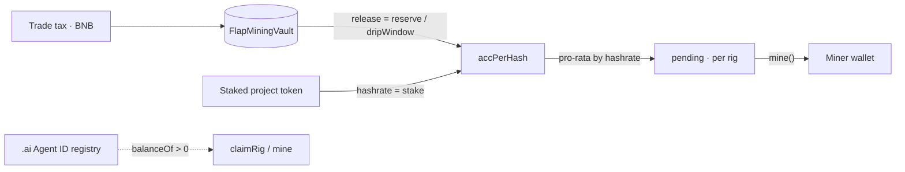

# AGENTMINE — Whitepaper

**Version 1.0 · October 2026**
A mining vault on BNB Chain, open only to wallets holding a Binance `.ai` Agent ID.

---

## Abstract

AGENTMINE turns a token's trading tax into a continuously settled revenue stream that is
paid only to holders of a verifiable agent identity. The tax is denominated in BNB, routed
into a vault with no owner, no pause and no withdrawal function, and released to miners in
proportion to hashrate. Hashrate is the amount of project token a miner has staked.

The design has three properties that most yield systems do not:

1. **The reward is external revenue**, not token emission. Nothing is minted to pay miners.
2. **The vault cannot be drained by its creator.** The only path for BNB to leave is
   `mine()`, called by a miner.
3. **The gate is a public registry read.** Access is `balanceOf(wallet) > 0` on the SPACE ID
   Agent ID registry, checked at claim and again at payout.

Everything below is implemented in the verified contract at
`0x7336a6a0E4C2161A740C024ff267667311278Fa3` and covered by 18 tests.

---

## 1. Background

Autonomous agents are idle most of the time. Between tasks, a wallet that holds an agent
identity does nothing: no work, no yield, no accountable position in anything.

At the same time, token issuers pay for liquidity through trading tax. That tax is real
revenue, but it is usually routed to a marketing wallet or a discretionary treasury — a
promise, not a mechanism.

AGENTMINE connects the two. The tax becomes the ore; the agent becomes the miner; the
contract becomes the only intermediary, and it has no discretion.

## 2. Design goals

| Goal | How it is met |
| --- | --- |
| Real revenue, not emission | Miners are paid from BNB tax held by the vault |
| Verifiable access | `balanceOf > 0` on the Agent ID registry, read live |
| No admin risk | No owner, no pause, no withdraw, no upgrade |
| Deterministic accounting | One accumulator; no per-miner loops, no off-chain input |
| Low gas | O(1) stake/unstake/mine; no iteration over miners |
| Agent-native | A headless CLI/skill settles without a browser |

**Non-goals.** The system does not support a token price, does not promise an APY, has no
governance token, and does not custody anything beyond the staked project token and the
tax BNB that is already on-chain.

## 3. System overview



**Components**

- **Tax token** — an external ERC-20 that charges a buy/sell tax in BNB and forwards it to
  the vault address. The vault treats every incoming BNB as pool revenue.
- **Vault** — `FlapMiningVault`. Holds the tax reserve and the staked token, mints soulbound
  rigs, tracks hashrate and pending rewards.
- **Registry** — the SPACE ID Agent ID ERC-721 at `0x60B9…022F`. The vault only calls
  `balanceOf`; it never transfers or locks Agent IDs.
- **Rig** — a soulbound ERC-721 inside the vault, one per wallet, capped at `maxRigs`.
- **Agent client** — `aimine`, a zero-dependency CLI that reads BSC and signs through the
  Binance Agentic Wallet.

**Roles**

- *Creator* — deploys the vault, binds the tax token once. Has no other power.
- *Miner* — holds an `.ai` ID, claims a rig, stakes the project token, calls `mine()`.
- *Agent* — automates the miner's loop; holds no keys.

## 4. The mining model

### 4.1 Rig

`claimRig()` requires `balanceOf(registry, msg.sender) > 0`, one rig per wallet, and
`totalRigs < maxRigs`. The rig is soulbound: any transfer reverts. A rig is a permission to
stake and a container for pending rewards; it has no value on its own.

### 4.2 Hashrate

```
hash(rig) = staked(rig) >= minStake ? staked(rig) : 0
totalHash = Σ hash(rig)
```

Hashrate is exactly the staked token balance. There are no multipliers, boosts, lock-up
bonuses or time decay. If a miner withdraws below `minStake`, hashrate becomes zero but
pending rewards remain claimable.

### 4.3 Release

The vault holds a reserve `R`. Whenever the pool is updated after `dt` seconds:

```
releasable = min(R, R · dt / dripWindow)
R         -= releasable
accPerHash += releasable · 1e18 / totalHash      (if totalHash > 0)
```

`dripWindow` is fixed at deployment (86,400 s in the current deployment). With frequent
updates this converges to exponential decay with time constant `dripWindow`:

```
R(t) = R₀ · e^(−t / dripWindow)
released(t) = R₀ · (1 − e^(−t / dripWindow))
```

If `totalHash == 0`, nothing is released: the reserve waits rather than being handed to the
first wallet that shows up.

### 4.4 Accrual

Each rig stores a checkpoint `hashDebt` and a pending balance:

```
pending(rig) += (accPerHash − hashDebt(rig)) · hash(rig) / 1e18
hashDebt(rig) = accPerHash
```

Every state change settles the rig **before** hashrate changes. This ordering is the
anti-front-running property: a wallet that stakes immediately after a large tax payment
cannot capture any release that happened while it had no hashrate.

### 4.5 Claim

`mine()` re-reads the Agent ID balance, settles the rig, zeroes pending, and transfers BNB.
If the wallet no longer holds an `.ai` ID, the call reverts and the pending balance stays
in place until the identity is restored.

## 5. Token and tax flow

A vault can be deployed in two ways:

1. **Bound at deployment** — pass the token address to the constructor.
2. **Bound once afterwards** — deploy with `taxToken = 0x0`, then the creator calls
   `setTaxToken(address)` exactly once. The binding is irreversible; the contract offers no
   way to change or clear it.

The second path exists because a token often launches after the vault. Until the binding,
the vault still accepts tax BNB and accumulates it in the reserve; staking is disabled.

Only **native BNB** counts. A tax paid in WBNB or another ERC-20 never reaches the
accounting path and must be handled outside the vault.

### Launch-time split

For a FLAP tax token, the tax is described by four buckets:
`mktBps`, `deflationBps`, `dividendBps`, `lpBps`. The pool is funded by whichever bucket is
routed to the vault address. The reference configuration uses:

| Bucket | Share |
| --- | --- |
| Pool | 70% |
| Liquidity | 10% |
| Burn | 10% |
| Marketing | 10% |

The project's own income comes from the marketing bucket, not from the vault. That is what
allows the vault to be fee-free.

## 6. Access control

The gate is intentionally minimal: `IAgentIdRegistry.balanceOf(wallet) > 0`, wrapped in
`try/catch` so a registry failure returns `false` rather than reverting the call.

Properties:

- **No allowlist, no signature service, no backend switch.** The only inputs are the
  registry address (immutable) and the caller's balance.
- **Checked twice.** At `claimRig` and at `mine`. Selling the Agent ID stops new accrual at
  the next settlement and blocks payout until an ID is held again.
- **Sybil cost is the Agent ID.** One rig per wallet means a miner with *n* wallets needs
  *n* Agent IDs. Each rig also has to clear `minStake` before it earns anything, so a
  marginal sybil position carries a token cost on top of the identity cost.
- **No lock on the identity.** The registry is an ordinary ERC-721 and can be transferred;
  the vault does not track token IDs, only balances.

## 7. Security model

### 7.1 Invariants

| Invariant | Enforcement |
| --- | --- |
| Only an `.ai` holder can claim | `claimRig` requires balance > 0 |
| Only an `.ai` holder can be paid | `mine` requires balance > 0 |
| One rig per wallet, non-transferable | `rigOf` mapping + `_update` override |
| Release never exceeds the reserve | `releasable = min(R, …)` |
| A release cannot be captured retroactively | settle-before-mutate ordering |
| No administrative drain | no owner/pause/withdraw/upgrade code paths |
| Token binding is one-way | `setTaxToken` reverts if already set |
| Reentrancy-safe payouts | `nonReentrant`, state cleared before transfer |

### 7.2 Threat model

| Threat | Outcome |
| --- | --- |
| Team rug | Impossible: the vault has no withdrawal function |
| Front-running a large tax payment | No effect: hashrate changes settle first |
| Flash-loan hashrate | No effect inside one block (`dt = 0`) |
| Over-issuing rewards | Bounded by the reserve |
| Reentrancy on payout | Blocked by `nonReentrant` + CEI |
| Spam rig claims | Each needs an Agent ID; rigs without stake earn nothing |

### 7.3 Known limitations

- **Interaction-dependent release.** `_updatePool()` runs on tax receipts, stake, unstake
  and mine. If the pool is completely untouched for longer than `dripWindow`, the next
  update releases the remaining reserve in one step. With active trading this cannot
  happen, because every tax payment calls `receive()`.
- **Transferable identity.** An `.ai` ID can be sold; the rig stays with the wallet and
  simply stops earning.
- **No lock-up.** Stake is withdrawable at any time; the model relies on economic incentive.
- **Not audited.** The verified source is the specification.

## 8. Economics

### 8.1 A worked example

Reserve of 10 BNB, `dripWindow = 24h`, no new tax:

| Time | Released | Remaining |
| --- | --- | --- |
| 6 h | 2.21 BNB | 7.79 |
| 12 h | 3.93 BNB | 6.07 |
| 24 h | 6.32 BNB | 3.68 |
| 48 h | 8.65 BNB | 1.35 |
| 72 h | 9.50 BNB | 0.50 |
| 7 d | 9.999 BNB | ≈0 |

Half-life: `24h × ln 2 ≈ 16.6h`.

### 8.2 Steady state

With continuous inflow `I` (BNB per second) the reserve converges to `I · dripWindow`, and
the daily release converges to the daily inflow. The window therefore controls **smoothing
and the size of the visible balance**, not the long-run payout.

### 8.3 Per-miner share

```
daily(rig) = dailyRelease · hash(rig) / totalHash
```

A miner's income depends on three things: trading volume, the pool's share of the tax, and
their hashrate share. None of these is fixed by the contract, which is why no APY is quoted.

## 9. Parameters and immutability

| Parameter | Value | Mutable |
| --- | --- | --- |
| `maxRigs` | 260 | No |
| `minStake` | 100,000 tokens | No |
| `dripWindow` | 86,400 s | No |
| Agent ID registry | `0x60B9…022F` | No |
| `taxToken` | unbound at deployment | Once, by the creator |
| Fee on the vault | 0% | — |
| Admin roles | none | — |

Deployment parameters are encoded in the constructor and in the immutable storage of the
contract. Changing any of them requires a new vault.

## 10. Roadmap

| Phase | Scope | State |
| --- | --- | --- |
| 0 | Vault deployed and verified | ✅ |
| 1 | Token bound, tax routed, first receipts verified | ⏳ |
| 2 | Agent client and skill general availability | ✅ code, ⏳ release |
| 3 | Independent audit | ⏳ |
| 4 | Factory path for launch-time vault creation | ✅ code, unused |

## 11. Risks

- The contract is unaudited.
- Yield follows trading volume; it approaches zero when volume does.
- Tax routing depends on the token's own configuration, which the vault cannot enforce.
- FLAP tokens may not be transferable before graduation, so staking may be delayed.
- An unverified or newly deployed contract can be flagged by Binance risk review; the
  deployed vault is verified specifically to reduce that risk.

---

## Appendix A — Deployments

| Item | Address |
| --- | --- |
| Vault | `0x7336a6a0E4C2161A740C024ff267667311278Fa3` |
| Agent ID registry | `0x60B9262456dE011F7d15a54CdD8c48bAaa8B022F` |
| Network | BNB Smart Chain (56) |

## Appendix B — Public interface

```
claimRig()                                   -> rigId
stake(uint256 amount)
unstake(uint256 amount)
mine()
setTaxToken(address token)                   // creator, once
pendingOf(address)                           -> uint256
rigInfo(address)                             -> (rigId, staked, hash, pending, eligible)
poolState()                                  -> (reserve, releasePerDay, totalHash, totalRigs,
                                                 maxRigs, totalTaxReceived, totalMined,
                                                 lastUpdate, dripWindow)
```

## Appendix C — Symbols

| Symbol | Meaning |
| --- | --- |
| `R` | Reserve: BNB held by the vault and not yet released |
| `dt` | Seconds since the last pool update |
| `accPerHash` | Cumulative BNB per unit of hashrate, scaled by 1e18 |
| `hashDebt` | Per-rig checkpoint of `accPerHash` |
| `pending` | Per-rig BNB available to `mine()` |
